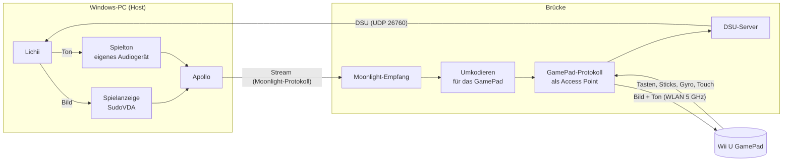

# lichii-wiiu-gamepad

 [](https://github.com/Mendeln00/lichii-wiiu-gamepad/actions/workflows/ci.yml) [](LICENSE)

> [!IMPORTANT]
> **Dieses Projekt ist zu 100 % KI‑Code.** Code und Doku schreibt [Claude Code](https://claude.com/claude-code). Der Maintainer gibt die Richtung vor, prüft und testet auf echter Hardware. Wer KI‑Code ablehnt, ist hier vermutlich nicht richtig, und das ist okay. Hilfe ist trotzdem immer willkommen: [Mitmachen](CONTRIBUTING.md).
>
> _English:_ 100 % of the code is AI-generated. If that's not for you, no hard feelings. Help is always welcome.

Den Switch‑Emulator [Lichii](https://github.com/zortos293/Lichii) mit dem **Wii U GamePad** spielen, **ganz ohne Wii U**: Bild und Ton laufen auf das GamePad, Tasten, Sticks, Gyro und Touch gehen zurück an den PC. Eine **Brücke** gibt sich dem GamePad gegenüber als Konsole aus: ein kleines Funkmodul am USB‑Port oder ein Linux‑Rechner mit WLAN‑Dongle. Lichii läuft dabei **isoliert**. Maus, Tastatur, Hauptbildschirm und Ton des PCs bleiben frei, du kannst also nebenher normal am PC arbeiten.

> _English:_ Play the Lichii emulator on a Wii U GamePad without a Wii U: a bridge (a small USB radio board or Linux with a Wi‑Fi dongle) acts as the console. Video and audio go to the GamePad, buttons/sticks/gyro/touch go back to the PC, and the PC stays usable for other work.

## Status

🚧 Frühe Phase. Den Fahrplan findest du in [docs/roadmap.md](docs/roadmap.md), den Stand in den [Milestones](../../milestones).

## So funktioniert es



Das Diagramm zeigt den Linux‑Weg. Im Toffee‑Weg liest die Brücke die Spielanzeige direkt auf dem Host, ohne Apollo ([ADR 0005](docs/adr/0005-direktmodus-als-ziel.md)).

Die Wii U braucht es nur für den Plan B, das **Relay**: Dann empfängt die Konsole den Stream und gibt ihn weiter ([wiiu/](wiiu/)).

Mehr dazu in [docs/architecture.md](docs/architecture.md) und den Entscheidungen unter [docs/adr/](docs/adr/).

## Voraussetzungen

| Seite | Was |
| --- | --- |
| PC | Windows 10/11, [Apollo](https://github.com/ClassicOldSong/Apollo) mit SudoVDA, Lichii. Optional [ViGEmBus](https://github.com/nefarius/ViGEmBus) als Rückfall für die Eingabe |
| Brücke | Wird gerade per Spike entschieden: ein ESP32‑C5‑Board am USB‑Port ([Toffee](https://github.com/Gavwalsh15/toffee_wiiu)) oder Linux mit USB‑WLAN‑Dongle (RTL8811AU). Details in [research/direct-mode.md](research/direct-mode.md) und [ADR 0005](docs/adr/0005-direktmodus-als-ziel.md) |
| Wii U | Nicht nötig. Nur für den Plan B (Relay) |

Prüfen, ob der PC bereit ist:

```powershell
Import-Module .\host\LichiiGamepad\LichiiGamepad.psd1
Test-LichiiGamepadHost -Detailed
```

Apollo auf Isolation einstellen (als Administrator, mit Backup, `-WhatIf` zeigt vorher, was passiert):

```powershell
Set-LichiiGamepadApolloConfig -RestartService
```

Für jedes Spiel im Spieleordner ein Spielprofil in Apollo anlegen (als Administrator, mit Backup von `apps.json`, `-WhatIf` geht auch hier). Erkannt werden `.xci`, `.nsp` von Basisspielen und entpackte Spiele (ein Ordner mit `exefs\main`). Updates und DLC als `.nsp` bekommen kein Profil. Hat eine `.nsp` kein Ticket, liest der Befehl ihre Titel‑ID mit dem `header_key` aus der `prod.keys` von Lichii. Er sucht sie unter `%APPDATA%\lichii\keys` und `user\keys` neben `lichii.exe`, sonst gibt man `-KeysPath` an. Der Schlüssel bleibt auf dem PC. Ohne Schlüssel bekommt so eine Datei kein Profil, nur eine Warnung, denn sie könnte ein Update sein.

Als Cover dient eine PNG‑Datei mit gleichem Namen neben dem Spiel, bei entpackten Spielen die erste PNG‑Datei im Ordner. Fehlt sie, sucht der Befehl wie „Find Cover“ in Apollo in der [GameDB](https://github.com/LizardByte/GameDB) nach dem Spiel für die Switch. Er lädt die Hülle hochkant mit dem Spielnamen darauf als PNG nach `config\covers` von Apollo. Wer das nicht will, gibt `-SkipCoverDownload` an. Spiele, die schon ein Profil haben, bleiben unberührt, auch wenn man das Profil umbenannt hat. `lichii.exe` nimmt der Befehl aus einem vorhandenen Profil, sonst gibt man `-LichiiPath` an. Der Neustart von Apollo beendet einen laufenden Stream:

```powershell
New-LichiiGamepadGameProfile -GamePath 'D:\Spiele' -RestartService
```

DSU in Lichii einschalten (Lichii vorher beenden, mit Backup, `-WhatIf` geht auch hier). Der Standard passt zu Toffee: DSU‑Server `127.0.0.1:26760`, Touch im Bereich des DS4‑Touchpads. Für eine andere Brücke gibt man `-DsuServer` und `-TouchDevice` an:

```powershell
Set-LichiiGamepadLichiiConfig
```

Den Spielton auf ein eigenes Gerät legen, etwa [VB‑CABLE](https://vb-audio.com/Cable/). Der Name muss genau so lauten wie in den Windows‑Soundeinstellungen, sonst spielt Lichii ohne Meldung auf dem Standardgerät. Erst einstellen, wenn die Brücke dieses Gerät aufnimmt, sonst ist das Spiel nirgends zu hören. Toffee kann das noch nicht ([research/audio-isolation.md](research/audio-isolation.md)). `-AudioDevice auto` stellt zurück:

```powershell
Set-LichiiGamepadLichiiConfig -AudioDevice 'CABLE Input (VB-Audio Virtual Cable)'
```

Ein Spiel, dessen Eigenschaften man in Lichii öffnet und mit OK schließt, behält danach oft sein eigenes Tongerät und folgt der Einstellung nicht mehr. `Test-LichiiGamepadHost` nennt solche Spiele und sagt, wie man sie zurückstellt.

## Projektaufbau

| Ordner | Inhalt |
| --- | --- |
| `host/` | PowerShell‑Modul für den Windows‑PC: Prüfung, Einrichtung und Start |
| `bridge/` | Die Brücke: Einrichtung, Konfiguration und Verweise auf unsere Forks |
| `wiiu/` | Plan B: Wii‑U‑Client als Fork von moonlight‑wiiu |
| `research/` | Recherchen und Spikes, z. B. zum GamePad‑Protokoll und zu Dongles |
| `docs/` | Architektur, ADRs, Roadmap, Agent‑Konventionen |

## Mitmachen

Am meisten helfen **Hardware‑Berichte**: Welcher WLAN‑Dongle läuft mit dem GamePad, welcher nicht? Dazu kommen Wissen über das GamePad‑Protokoll, Tests, Reviews und Code. Fragen und Ideen gehören in die [Discussions](https://github.com/Mendeln00/lichii-wiiu-gamepad/discussions). Wie alles abläuft, steht in [CONTRIBUTING.md](CONTRIBUTING.md). Deutsch und Englisch sind beide willkommen.

## Verwandte Projekte

Die Projekte, auf denen wir aufbauen oder von denen wir lernen, stehen in [docs/related-projects.md](docs/related-projects.md).

## Lizenz

[GPL‑3.0‑or‑later](LICENSE), passend zu moonlight‑wiiu, Apollo und Lichii.
