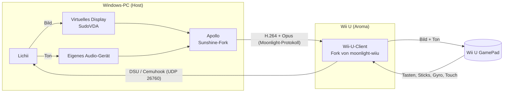

# lichii-wiiu-gamepad

 [](https://github.com/Mendeln00/lichii-wiiu-gamepad/actions/workflows/ci.yml) [](LICENSE)

> [!IMPORTANT]
> **Dieses Projekt ist zu 100 % KI‑Code.** Code und Doku schreibt [Claude Code](https://claude.com/claude-code). Der Maintainer gibt die Richtung vor, prüft und testet auf echter Hardware. Wer KI‑Code ablehnt, ist hier vermutlich nicht richtig, und das ist okay. Hilfe ist trotzdem immer willkommen: [Mitmachen](CONTRIBUTING.md).
>
> _English:_ 100 % of the code is AI-generated. If that's not for you, no hard feelings. Help is always welcome.

Den Switch‑Emulator [Lichii](https://github.com/zortos293/Lichii) mit dem **Wii U GamePad** spielen: Bild und Ton laufen auf das GamePad, Tasten, Sticks, Gyro und Touch gehen zurück an den PC. Lichii läuft dabei **isoliert**. Maus, Tastatur, Hauptbildschirm und Ton des PCs bleiben frei, du kannst also nebenher normal am PC arbeiten.

> _English:_ Play the Lichii emulator on a Wii U GamePad (video + audio to the GamePad, buttons/sticks/gyro/touch back to the PC) while the PC stays usable for other work.

## Status

🚧 Frühe Phase. Den Fahrplan findest du in [docs/roadmap.md](docs/roadmap.md), den Stand in den [Milestones](../../milestones).

## So funktioniert es



Mehr dazu in [docs/architecture.md](docs/architecture.md) und den Entscheidungen unter [docs/adr/](docs/adr/).

## Voraussetzungen

| Seite | Was |
| --- | --- |
| PC | Windows 10/11, [Apollo](https://github.com/ClassicOldSong/Apollo) mit SudoVDA, [ViGEmBus](https://github.com/nefarius/ViGEmBus), Lichii |
| Wii U | Homebrew mit [Aroma](https://aroma.foryour.cafe/), SD‑Karte, möglichst LAN‑Adapter |
| Netz | PC und Wii U im selben Netz, am besten per Kabel |

Prüfen, ob der PC bereit ist:

```powershell
Import-Module .\host\LichiiGamepad\LichiiGamepad.psd1
Test-LichiiGamepadHost -Detailed
```

Apollo auf Isolation einstellen (als Administrator, mit Backup, `-WhatIf` zeigt vorher, was passiert):

```powershell
Set-LichiiGamepadApolloConfig -RestartService
```

## Projektaufbau

| Ordner | Inhalt |
| --- | --- |
| `host/` | PowerShell‑Modul für den Windows‑PC: Prüfung, Einrichtung und Start |
| `wiiu/` | Wii‑U‑Client (folgt als Fork von moonlight‑wiiu, siehe Roadmap) |
| `research/` | Recherchen und Spikes, z. B. Direktverbindung ohne Wii U |
| `docs/` | Architektur, ADRs, Roadmap, Agent‑Konventionen |

## Mitmachen

Am meisten helfen **Hardware‑Berichte**: Welcher WLAN‑Dongle läuft mit dem GamePad, welcher nicht? Dazu kommen Wissen über das GamePad‑Protokoll, Tests, Reviews und Code. Fragen und Ideen gehören in die [Discussions](https://github.com/Mendeln00/lichii-wiiu-gamepad/discussions). Wie alles abläuft, steht in [CONTRIBUTING.md](CONTRIBUTING.md). Deutsch und Englisch sind beide willkommen.

## Verwandte Projekte

Die Projekte, auf denen wir aufbauen oder von denen wir lernen, stehen in [docs/related-projects.md](docs/related-projects.md).

## Lizenz

[GPL‑3.0‑or‑later](LICENSE), passend zu moonlight‑wiiu, Apollo und Lichii.
