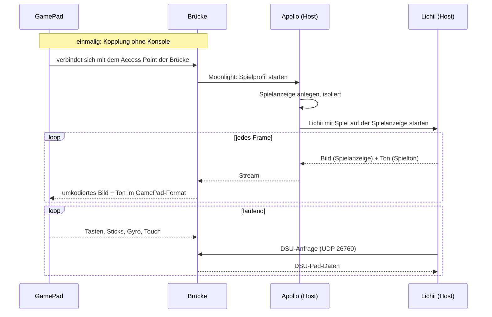

# Architektur

## Ziel

1. Bild und Ton von Lichii laufen auf das **GamePad**, ganz ohne Wii U (**Direktmodus**, [ADR 0005](adr/0005-direktmodus-als-ziel.md)).
2. Tasten, Sticks, Gyro und Touch des GamePads steuern **nur Lichii**.
3. Der Host bleibt nebenher normal nutzbar (**Isolation**).

## Bausteine

| Baustein | Läuft auf | Aufgabe | Basis |
| --- | --- | --- | --- |
| Lichii | Host | Emulator. Liest Eingaben per DSU. Fürs GamePad läuft `eden-cli.exe` mit der **GamePad‑Konfiguration** ([ADR 0007](adr/0007-eden-cli-mit-eigener-konfiguration.md)). | upstream, unverändert |
| Apollo | Host | Erzeugt pro Stream die **Spielanzeige**, kodiert Bild und Ton und spricht das Moonlight‑Protokoll. | upstream, nur konfiguriert |
| `host/LichiiGamepad` | Host | PowerShell‑Modul: prüft Voraussetzungen, richtet Apollo und Lichii ein, startet die Brücke. | eigen |
| **Brücke** | je nach Spike: Windows‑App mit ESP32‑C5 am USB oder Linux mit USB‑WLAN‑Dongle | Gibt sich dem GamePad gegenüber als Konsole aus: Kopplung, eigener Access Point, GamePad‑Protokoll für Bild, Ton und Eingabe. Kodiert das Bild eigens für das GamePad und stellt den DSU‑Server bereit. | Fork von [Toffee](https://github.com/Gavwalsh15/toffee_wiiu) oder [Barista](https://github.com/BetaZay/Barista), siehe [ADR 0005](adr/0005-direktmodus-als-ziel.md) |
| Client für die Konsole | Wii U | Nur Plan B (Relay) | Fork von [moonlight‑wiiu](https://github.com/GaryOderNichts/moonlight-wiiu) |

Im Linux‑Weg ist die Brücke **Client** im Sinne von Apollo: Sie meldet sich per Moonlight‑Pairing an wie jede andere Moonlight‑App. Im Toffee‑Weg liest die Windows‑App die Spielanzeige selbst, Apollo ist dann nicht im Bildpfad. Welcher Weg es wird, entscheidet ein ADR nach den Spikes. Das Diagramm zeigt den Linux‑Weg.

## Datenflüsse

## Isolation: Wie bleibt der Host frei?

| Kanal | Maßnahme | Ergebnis |
| --- | --- | --- |
| Bild | Apollo „Virtual Display“ pro Spielprofil, `dd_configuration_option = ensure_active` (**nicht** `ensure_primary`) und „isolated virtual display“ | Der Hauptbildschirm bleibt primär. Die Maus gerät nicht versehentlich auf die Spielanzeige. |
| Ton | Lichii gibt auf ein eigenes Gerät aus, Apollo nimmt genau dieses Gerät auf | Host‑Ton (Musik, Calls) bleibt am PC. Nur der Spielton geht zum GamePad. |
| Eingabe | DSU: Lichii fragt die Brücke direkt per UDP ab. Apollo nimmt keine Maus‑ und Tastatureingaben an (`mouse = disabled`, `keyboard = disabled`). | Keine globalen Eingaben auf dem Host. Gyro und Touch kommen nativ an. |
| Einstellungen | Spielprofile starten `eden-cli.exe` mit der GamePad‑Konfiguration statt `lichii.exe` mit `qt-config.ini` | Spieler 1 und das Tongerät des normalen Lichii bleiben, wie sie sind. Spielstände teilen beide. |
| Funk | Die Brücke betreibt ihr eigenes WLAN nur für das GamePad, über eigene Funk‑Hardware am USB | Das WLAN und das Netz des PCs bleiben unberührt. |

## Warum so?

Die Begründungen stehen in den ADRs unter [adr/](adr/).
