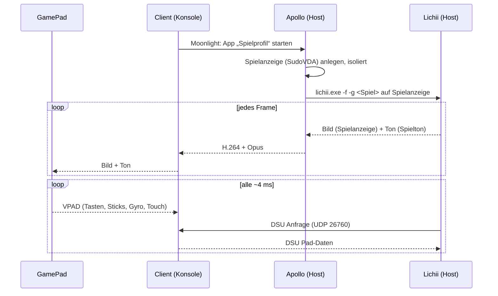

# Architektur

## Ziel

1. Bild und Ton von Lichii laufen auf das **GamePad**.
2. Tasten, Sticks, Gyro und Touch des GamePads steuern **nur Lichii**.
3. Der Host bleibt nebenher normal nutzbar (**Isolation**).

## Bausteine

| Baustein | Läuft auf | Aufgabe | Basis |
| --- | --- | --- | --- |
| Lichii | Host | Emulator. Liest Eingaben per DSU oder SDL. | upstream, unverändert |
| Apollo | Host | Erzeugt pro Stream die **Spielanzeige**, kodiert H.264, liefert Opus und spricht das Moonlight‑Protokoll. | upstream, nur konfiguriert |
| `host/LichiiGamepad` | Host | PowerShell‑Modul: prüft Voraussetzungen, richtet Apollo und Lichii ein, erzeugt **Spielprofile**. | eigen |
| Client | Konsole | Empfängt den Stream, dekodiert ihn in Hardware, zeigt ihn auf dem GamePad und spielt den Ton ab. Liest das GamePad aus und stellt einen DSU‑Server bereit. | Fork von [moonlight‑wiiu](https://github.com/GaryOderNichts/moonlight-wiiu) |

## Datenflüsse

## Isolation: Wie bleibt der Host frei?

| Kanal | Maßnahme | Ergebnis |
| --- | --- | --- |
| Bild | Apollo „Virtual Display“ pro Spielprofil, `dd_configuration_option = ensure_active` (**nicht** `ensure_primary`) und „isolated virtual display“ | Hauptbildschirm bleibt primär. Die Maus gerät nicht versehentlich auf die Spielanzeige. |
| Ton | Lichii gibt auf ein eigenes Gerät aus (z. B. VB‑CABLE oder Steam Streaming Speakers). Apollo nimmt genau dieses Gerät auf. | Host‑Ton (Musik, Calls) bleibt am PC. Nur der Spielton geht zum GamePad. |
| Eingabe | DSU: Lichii fragt den Client direkt per UDP ab. Apollo bekommt keine Maus‑ und Tastatureingaben (`mouse = disabled`, `keyboard = disabled`). | Keine globalen Eingaben auf dem Host, Gyro und Touch kommen nativ an. |

## Warum so?

Die Begründungen stehen in den ADRs unter [adr/](adr/).
