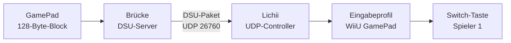

# Tastenbelegung

Diese Seite legt fest, welche DSU‑Taste die Brücke für jede Taste des GamePads sendet und welche Switch‑Taste Lichii daraus macht. Sie gilt für jeden DSU‑Server des Projekts: im Direktmodus die Brücke, im Relay den Client. Das Host‑Modul baut das Eingabeprofil `WiiU GamePad` nach dieser Tabelle (`ConvertTo-LichiiInputProfile`, [#52](https://github.com/Mendeln00/lichii-wiiu-gamepad/issues/52)).

Stand: 2026-11-28. Die Belege zeigen auf feste Commits: [DSU‑Spezifikation][dsu] `82bf8a8`, Lichii `fdc7cdaf`, Toffee `85051f0` (v0.1.1, zugleich `master`), libdrc `eb53344`.

Kennzeichnung: **(belegt)** heißt, die verlinkte Quelle sagt das so. **(Schluss)** heißt, das ist unsere Ableitung, nicht getestet. Ob jede Eingabe auf echter Hardware richtig ankommt, prüft [#31](https://github.com/Mendeln00/lichii-wiiu-gamepad/issues/31).

## Weg einer Eingabe

## Kurz

- Wii U und Switch haben die vier Haupttasten an derselben Stelle: A rechts, B unten, X oben, Y links. Die Belegung folgt der Lage. So belegt Lichii einen UDP‑Controller ohnehin, das Eingabeprofil muss nichts umlegen. (belegt, Tabelle unten)
- DSU benennt die Haupttasten nach ihrer Lage. Die Spezifikation nutzt dafür Nintendos Namen Y, B, A, X ([DSU L141-L144][dsu-buttons]), Lichii die von PlayStation: Square, Cross, Circle, Triangle ([udp_client.h L69-L91][li-padbutton]). Gemeint sind dieselben Bits. (belegt)
- **Toffee sendet das zweite Tastenbyte in falscher Reihenfolge.** Acht Tasten kommen in Lichii vertauscht an, siehe [Fehler in Toffee](#fehler-in-toffee). Das Eingabeprofil gleicht das nicht aus. Der Fehler gehört zu Toffee.
- Ohne Gegenstück sind TV, POWER und SYNC am GamePad und Capture an der Switch. Was HOME und TV auslösen und ein Vorschlag für Capture stehen [unten](#tasten-ohne-gegenstück).

## Tasten

Spalten:

- **GamePad‑Bit**: Lage im Eingabeblock des GamePads. „Tasten“ ist das 16‑Bit‑Feld `buttons`, „Extra“ das Byte `extra_buttons` ([libdrc L45-L62, L99-L103][drc-buttons]).
- **DSU**: Byte im Paket ab Beginn der Nutzdaten und Wert des Bits ([DSU L130, L141-L144][dsu-buttons]).
- **Switch**: Taste in Lichii und Schlüssel im Eingabeprofil ([udp_client.cpp L409-L452][li-map]). Lichii liest die beiden Tastenbytes als ein 16‑Bit‑Feld ([udp_client.cpp L314-L327][li-paddata]).
- **Toffee 0.1.1**: was davon heute in Lichii ankommt ([dsu_server.cpp L224-L231][tf-bytes]).

| GamePad | GamePad‑Bit | DSU | Switch | Toffee 0.1.1 | Belege |
| --- | --- | --- | --- | --- | --- |
| A | Tasten `0x8000` | A (Circle), Byte 17, `32` | A, `button_a` | ZR ❌ | [libdrc][drc-buttons], [DSU][dsu-buttons], [Lichii][li-map], [Toffee][tf-bytes] |
| B | Tasten `0x4000` | B (Cross), Byte 17, `64` | B, `button_b` | L ❌ | [libdrc][drc-buttons], [DSU][dsu-buttons], [Lichii][li-map], [Toffee][tf-bytes] |
| X | Tasten `0x2000` | X (Triangle), Byte 17, `16` | X, `button_x` | ZL ❌ | [libdrc][drc-buttons], [DSU][dsu-buttons], [Lichii][li-map], [Toffee][tf-bytes] |
| Y | Tasten `0x1000` | Y (Square), Byte 17, `128` | Y, `button_y` | R ❌ | [libdrc][drc-buttons], [DSU][dsu-buttons], [Lichii][li-map], [Toffee][tf-bytes] |
| L | Tasten `0x0020` | L1, Byte 17, `4` | L, `button_l` | A ❌ | [libdrc][drc-buttons], [DSU][dsu-buttons], [Lichii][li-map], [Toffee][tf-bytes] |
| R | Tasten `0x0010` | R1, Byte 17, `8` | R, `button_r` | X ❌ | [libdrc][drc-buttons], [DSU][dsu-buttons], [Lichii][li-map], [Toffee][tf-bytes] |
| ZL | Tasten `0x0080` | L2, Byte 17, `1` | ZL, `button_zl` | Y ❌ | [libdrc][drc-buttons], [DSU][dsu-buttons], [Lichii][li-map], [Toffee][tf-bytes] |
| ZR | Tasten `0x0040` | R2, Byte 17, `2` | ZR, `button_zr` | B ❌ | [libdrc][drc-buttons], [DSU][dsu-buttons], [Lichii][li-map], [Toffee][tf-bytes] |
| L3 (linken Stick drücken) | Extra `0x80` | L3, Byte 16, `2` | linken Stick drücken, `button_lstick` | richtig | [libdrc][drc-buttons], [DSU][dsu-buttons], [Lichii][li-map], [Toffee][tf-bytes] |
| R3 (rechten Stick drücken) | Extra `0x40` | R3, Byte 16, `4` | rechten Stick drücken, `button_rstick` | richtig | [libdrc][drc-buttons], [DSU][dsu-buttons], [Lichii][li-map], [Toffee][tf-bytes] |
| + | Tasten `0x0008` | Options, Byte 16, `8` | +, `button_plus` | richtig | [libdrc][drc-buttons], [DSU][dsu-buttons], [Lichii][li-map], [Toffee][tf-bytes] |
| − | Tasten `0x0004` | Share, Byte 16, `1` | −, `button_minus` | richtig | [libdrc][drc-buttons], [DSU][dsu-buttons], [Lichii][li-map], [Toffee][tf-bytes] |
| ↑ | Tasten `0x0200` | Up, Byte 16, `16` | ↑, `button_dup` | richtig | [libdrc][drc-buttons], [DSU][dsu-buttons], [Lichii][li-map], [Toffee][tf-bytes] |
| → | Tasten `0x0400` | Right, Byte 16, `32` | →, `button_dright` | richtig | [libdrc][drc-buttons], [DSU][dsu-buttons], [Lichii][li-map], [Toffee][tf-bytes] |
| ↓ | Tasten `0x0100` | Down, Byte 16, `64` | ↓, `button_ddown` | richtig | [libdrc][drc-buttons], [DSU][dsu-buttons], [Lichii][li-map], [Toffee][tf-bytes] |
| ← | Tasten `0x0800` | Left, Byte 16, `128` | ←, `button_dleft` | richtig | [libdrc][drc-buttons], [DSU][dsu-buttons], [Lichii][li-map], [Toffee][tf-bytes] |
| HOME | Tasten `0x0002` | HOME, Byte 18, `1` | HOME, `button_home` | richtig | [libdrc][drc-buttons], [DSU][dsu-buttons], [Lichii][li-map], [Toffee][tf-bytes]; festgelegt [unten](#home) |
| TV | Extra `0x20` | – | – | wird nicht gesendet | [libdrc][drc-buttons], [Toffee][tf-bytes]; festgelegt [unten](#tv) |
| POWER | `power_status` `0x02` | – | – | wird nicht gesendet | [libdrc][drc-buttons]; [unten](#power-und-sync) |
| SYNC | Tasten `0x0001` | – | – | wird nicht gesendet | [libdrc][drc-buttons], [Toffee][tf-masks]; [unten](#power-und-sync) |
| – (keine Taste) | – | Touch Button, Byte 19, `1` | Capture, `button_screenshot` | immer 0 | [DSU][dsu-buttons], [Lichii][li-map], [Toffee][tf-bytes]; Vorschlag [unten](#screenshot-capture) |

SL und SR gibt es nur an Joy‑Cons. Lichii legt sie auf L2 und R2 ([udp_client.cpp L427-L430][li-map]), das Eingabeprofil übernimmt das. Für den Pro Controller spielen sie keine Rolle. (belegt)

## Sticks, Gyro und Touch

| Eingabe | GamePad liefert | Brücke sendet (DSU) | In Lichii | Offen | Belege |
| --- | --- | --- | --- | --- | --- |
| Linker Stick | X und Y als 16‑Bit‑Rohwert. Toffee nimmt 900 bis 3200, Mitte 2050 | Byte 20 und 21, 0 bis 255, Mitte 128, Y plus nach oben | Achsen 0 und 1, `lstick` | Richtung von Y: Toffee rechnet den Rohwert ohne Umkehr um. Dass er nach oben wächst, ist nicht belegt. Prüfung in #31 | [libdrc][drc-struct], [Toffee][tf-sticks], [Toffee‑Werte][tf-consts], [DSU][dsu-sticks], [Lichii][li-sticks] |
| Rechter Stick | wie links | Byte 22 und 23 | Achsen 2 und 3, `rstick` | wie links | [libdrc][drc-struct], [Toffee][tf-sticks], [Toffee‑Werte][tf-consts], [DSU][dsu-sticks], [Lichii][li-sticks] |
| Beschleunigung | X, Y, Z als 16 Bit mit Vorzeichen. Toffee: 8000 entsprechen 1 g | Byte 56 bis 67, Gleitkomma in g | Bewegung 0, `motionleft` und `motionright`. Lichii ordnet die Achsen dabei um (Y wird −Z, Z wird Y) | Achsen und Vorzeichen, Prüfung in #31 | [libdrc][drc-motion], [Toffee][tf-motion], [Toffee‑Werte][tf-consts], [DSU][dsu-motion], [Lichii][li-motion] |
| Gyro | drei Werte zu 24 Bit, bei libdrc benannt als Roll, Yaw, Pitch. Toffee rechnet in Grad pro Sekunde um | Byte 68 bis 79, Gleitkomma in Grad pro Sekunde: Pitch, Yaw, Roll | Bewegung 0, `motionleft` und `motionright`. Lichii ordnet auch hier um und teilt durch 312 | Toffee schreibt die Werte in der Reihenfolge des GamePads in die Felder Pitch, Yaw, Roll und hat das selbst noch nicht mit einem DSU‑Client geprüft ([framework.md L84-L86][tf-framework]). Ob libdrcs Namen dieselben Achsen meinen, ist offen. Prüfung in #31 | [libdrc][drc-motion], [Toffee][tf-motion], [Toffee‑Werte][tf-consts], [DSU][dsu-motion], [Lichii][li-motion] |
| Touch | ein Punkt, zehnmal gemessen, je 12 Bit für X und Y, dazu ein Druckwert | Erster Touch ab Byte 36. Toffee mittelt die Messungen, dreht Y um und skaliert 0 bis 4095 auf X 0 bis 1919 und Y 0 bis 941. Berührt heißt Druck ungleich 0. Der zweite Touch bleibt leer | Touch 1 auf `axis_x:17`, `axis_y:18`. Das Host‑Modul setzt `touch_device` auf `min_x:0,min_y:0,max_x:1919,max_y:941` | Erreicht den Touchscreen der Switch noch nicht. Das ist ein Fehler in Lichii ([#62](https://github.com/Mendeln00/lichii-wiiu-gamepad/issues/62), [zortos293/Lichii#2675](https://github.com/zortos293/Lichii/issues/2675)) | [libdrc][drc-touch], [Toffee][tf-touchraw], [Toffee DSU][tf-touch], [DSU][dsu-touch], [Lichii][li-touch] |

Für die Mausbedienung nutzt Toffee beim Touch nur den Rohbereich 100 bis 3995 (X) und 200 bis 3895 (Y), für DSU dagegen 0 bis 4095 ([input_controller.cpp L105-L110][tf-mouse], [dsu_server.cpp L244-L245][tf-touch]). (belegt) An den Rändern erreicht DSU‑Touch also womöglich nicht ganz 0 und 1919. (Schluss) Die Kalibrierung regeln [#12](https://github.com/Mendeln00/lichii-wiiu-gamepad/issues/12) und [#25](https://github.com/Mendeln00/lichii-wiiu-gamepad/issues/25).

## Tasten ohne Gegenstück

HOME und TV hat der Maintainer am 2026-11-28 festgelegt ([PR #64](https://github.com/Mendeln00/lichii-wiiu-gamepad/pull/64)). Für Screenshot steht hier ein Vorschlag. Bauen muss das die Brücke, nach der Wahl der Plattform ([#33](https://github.com/Mendeln00/lichii-wiiu-gamepad/issues/33)). Das Menü der Brücke ist [#19](https://github.com/Mendeln00/lichii-wiiu-gamepad/issues/19).

### HOME

Was feststeht:

- DSU hat für HOME ein eigenes Byte (Byte 18, [DSU L143][dsu-buttons]). Lichii legt es auf Switch‑HOME ([udp_client.cpp L433][li-map]). (belegt)
- Lichii unterscheidet einen kurzen Druck (unter 400 ms) und einen langen. Beides meldet es dem Home‑Menü, dem Overlay und dem Spiel ([button_poller.cpp L20-L34, L60-L115][li-poller], [window_system.cpp L210-L268][li-window]). (belegt)
- In der Qt‑Oberfläche (`lichii.exe`) ist HOME auch Teil von Tastenkürzeln: HOME+− beendet Lichii, HOME+Plus hält an, HOME+B schaltet den Vollbildmodus, HOME+X den Docked‑Modus ([uisettings.cpp L34-L62][li-hotkeys]). (belegt) Im Code von `eden-cli` (`src/lichii_cmd`) gibt es keine Tastenkürzel. Fürs GamePad läuft `eden-cli` ([ADR 0007](adr/0007-eden-cli-mit-eigener-konfiguration.md)). (Schluss)
- HOME darf Windows nicht als Guide‑Taste erreichen, sonst öffnet sich womöglich die Xbox Game Bar ([#53](https://github.com/Mendeln00/lichii-wiiu-gamepad/issues/53)). Über DSU geschieht das nicht. Toffee legt HOME nur beim virtuellen Xbox‑360‑Controller auf Guide ([virtual_controller.cpp L49][tf-xbox]). Diese Option bleibt im Direktmodus aus. (belegt)

**Festgelegt:**

- **Standard: HOME → Switch‑HOME** über DSU‑Byte 18. Nur so lösen Spiele und Lichii HOME aus. Die Brücke reicht HOME unverändert durch und wertet einen langen Druck nicht selbst aus, denn Lichii nutzt den langen Druck schon.
- **Einstellbar in der Brücke: „HOME und TV tauschen“.** Dann öffnet HOME das Menü der Brücke und TV sendet Switch‑HOME. So bleiben beide Funktionen erreichbar, und es braucht keine Tastenkombination.

### TV

Was feststeht:

- Das GamePad meldet TV im Byte `extra_buttons` ([libdrc L99-L103][drc-buttons]). Toffee liest die Taste ([gamepad_buttons.h L9][tf-masks]), sendet sie aber weder per DSU noch an den virtuellen Xbox‑Controller ([dsu_server.cpp L226-L231][tf-bytes], [virtual_controller.cpp L37-L50][tf-xbox]). (belegt)
- DSU hat keine freie Taste: Die 16 Bits, HOME und der Touch Button sind vergeben ([DSU L141-L144][dsu-buttons]). (belegt)

**Festgelegt: TV → Menü der Brücke.** Die Switch hat keine TV‑Taste, und so bleibt jede Spieltaste frei. Solange das Menü offen ist, sendet die Brücke einen Ruhezustand an Lichii: keine Taste gedrückt, Sticks in der Mitte. Sonst steuert das Bedienen des Menüs nebenbei das Spiel. (Schluss)

### Screenshot (Capture)

Was feststeht:

- Das GamePad hat keine Capture‑Taste ([libdrc L45-L62, L99-L103][drc-buttons]). (belegt)
- Lichii legt Capture auf den Touch Button von DSU, Byte 19 ([udp_client.cpp L434][li-map]). Toffee sendet dort immer 0 ([dsu_server.cpp L231][tf-bytes]). Lichii meldet Capture wie HOME als kurzen oder langen Druck ([button_poller.cpp L63-L115][li-poller]). (belegt)
- In der Qt‑Oberfläche löst Capture zusätzlich Lichiis eigenen Screenshot aus ([uisettings.cpp L37][li-hotkeys]). (belegt)

**Vorschlag: keine feste Taste.** Alle freien Tasten des GamePads haben schon eine Aufgabe. Das Menü der Brücke bekommt einen Eintrag „Screenshot“, der kurz Byte 19 setzt. (Schluss)

### POWER und SYNC

- POWER steckt nicht im Tastenfeld, sondern im Byte `power_status` ([libdrc L64-L69][drc-buttons]). Die Taste schaltet das GamePad aus. (belegt)
- SYNC braucht man zur Kopplung ([research/direct-mode.md](../research/direct-mode.md#ablauf-für-den-nutzer)). (belegt)
- Beide gibt die Brücke nicht an Lichii weiter. Ein versehentlicher Druck soll im Spiel nichts auslösen. (Schluss)

## Fehler in Toffee

Toffee schreibt das zweite Tastenbyte (Byte 17) in umgekehrter Reihenfolge ([dsu_server.cpp L228-L229][tf-bytes]). (belegt)

| Wert | Spezifikation | Lichii | Toffee 0.1.1 schreibt | Ankunft in Lichii |
| --- | --- | --- | --- | --- |
| `1` | L2 | ZL | X | X wird ZL |
| `2` | R2 | ZR | A | A wird ZR |
| `4` | L1 | L | B | B wird L |
| `8` | R1 | R | Y | Y wird R |
| `16` | X (Triangle) | X | R | R wird X |
| `32` | A (Circle) | A | L | L wird A |
| `64` | B (Cross) | B | ZR | ZR wird B |
| `128` | Y (Square) | Y | ZL | ZL wird Y |

Belege: [DSU L130, L142][dsu-buttons], [Lichii udp_client.cpp L314-L324][li-paddata], [Toffee dsu_server.cpp L228-L229][tf-bytes].

Dass es ein Fehler ist und keine Absicht, zeigt Toffee selbst (belegt):

- Das erste Tastenbyte (Byte 16) folgt der Spezifikation ([dsu_server.cpp L226-L227][tf-bytes]).
- Die analogen Tasten im selben Paket (Byte 28 bis 35) stehen richtig: Y, B, A, X, R, L, ZR, ZL ([dsu_server.cpp L234-L237][tf-analog]).
- Toffees Kommentar und Doku sagen „rechts Circle, unten Cross, oben Triangle, links Square“ und „ZL und ZR sind L2 und R2“ ([dsu_server.cpp L224-L225][tf-bytes], [framework.md L81-L82][tf-framework]).

Richtig wäre ZL = `1`, ZR = `2`, L = `4`, R = `8`, X = `16`, A = `32`, B = `64`, Y = `128`.

Sichtbar ist der Fehler auch ohne GamePad: `toffee-cli dsu --simulate` drückt der Reihe nach A, B, X, Y ([main.cpp L402-L413][tf-simulate]). Nach dem Code kommen sie in Lichii als ZR, L, ZL, R an. (Schluss, nicht ausgeführt)

Wir gleichen den Fehler **nicht** im Eingabeprofil aus. Nach einem Fix in Toffee wäre das Profil sonst falsch. Gemeldet ist der Fehler als [Gavwalsh15/toffee_wiiu#2](https://github.com/Gavwalsh15/toffee_wiiu/issues/2).

## Wo die Belegung umgesetzt ist

| Stelle | Was | Stand |
| --- | --- | --- |
| `ConvertTo-LichiiInputProfile` im Host‑Modul | Eingabeprofil nach der Spalte „Switch“, einzelne Tasten per `-ButtonMap` | umgesetzt ([#52](https://github.com/Mendeln00/lichii-wiiu-gamepad/issues/52)) |
| `research/tools/Start-DsuTestServer.ps1` | sendet DSU‑Tasten direkt mit ihrem Namen, ohne GamePad | umgesetzt ([#60](https://github.com/Mendeln00/lichii-wiiu-gamepad/issues/60)) |
| Brücke, Toffee‑Weg | sendet nach der Spalte „DSU“, sobald Toffee den Fehler behebt | offen, gemeldet als [Gavwalsh15/toffee_wiiu#2](https://github.com/Gavwalsh15/toffee_wiiu/issues/2) |
| Brücke, Linux‑Weg | Barista hat keinen DSU‑Server. Unserer folgt dieser Tabelle | offen ([#32](https://github.com/Mendeln00/lichii-wiiu-gamepad/issues/32)) |
| HOME, TV, Screenshot | HOME und TV wie festgelegt, Screenshot wie vorgeschlagen | offen ([#19](https://github.com/Mendeln00/lichii-wiiu-gamepad/issues/19), nach [#33](https://github.com/Mendeln00/lichii-wiiu-gamepad/issues/33)) |

[dsu]: https://github.com/v1993/cemuhook-protocol/blob/82bf8a837cc7d2254e9257729f462a233d9ad184/README.md
[dsu-buttons]: https://github.com/v1993/cemuhook-protocol/blob/82bf8a837cc7d2254e9257729f462a233d9ad184/README.md?plain=1#L130-L144
[dsu-sticks]: https://github.com/v1993/cemuhook-protocol/blob/82bf8a837cc7d2254e9257729f462a233d9ad184/README.md?plain=1#L131-L148
[dsu-motion]: https://github.com/v1993/cemuhook-protocol/blob/82bf8a837cc7d2254e9257729f462a233d9ad184/README.md?plain=1#L133-L169
[dsu-touch]: https://github.com/v1993/cemuhook-protocol/blob/82bf8a837cc7d2254e9257729f462a233d9ad184/README.md?plain=1#L134-L178
[drc-buttons]: https://github.com/opencma/libdrc/blob/eb53344e4cd68500ca050c14c182ee3173c08848/web/docs/re/sc-input.rst?plain=1#L25-L103
[drc-struct]: https://github.com/opencma/libdrc/blob/eb53344e4cd68500ca050c14c182ee3173c08848/web/docs/re/sc-input.rst?plain=1#L25-L43
[drc-motion]: https://github.com/opencma/libdrc/blob/eb53344e4cd68500ca050c14c182ee3173c08848/web/docs/re/sc-input.rst?plain=1#L71-L81
[drc-touch]: https://github.com/opencma/libdrc/blob/eb53344e4cd68500ca050c14c182ee3173c08848/web/docs/re/sc-input.rst?plain=1#L87-L113
[li-padbutton]: https://github.com/zortos293/Lichii/blob/fdc7cdaf8df179775685d0afb57fca178f876a51/src/input_common/drivers/udp_client.h#L69-L91
[li-map]: https://github.com/zortos293/Lichii/blob/fdc7cdaf8df179775685d0afb57fca178f876a51/src/input_common/drivers/udp_client.cpp#L409-L452
[li-paddata]: https://github.com/zortos293/Lichii/blob/fdc7cdaf8df179775685d0afb57fca178f876a51/src/input_common/drivers/udp_client.cpp#L314-L327
[li-sticks]: https://github.com/zortos293/Lichii/blob/fdc7cdaf8df179775685d0afb57fca178f876a51/src/input_common/drivers/udp_client.cpp#L305-L312
[li-motion]: https://github.com/zortos293/Lichii/blob/fdc7cdaf8df179775685d0afb57fca178f876a51/src/input_common/drivers/udp_client.cpp#L254-L269
[li-touch]: https://github.com/zortos293/Lichii/blob/fdc7cdaf8df179775685d0afb57fca178f876a51/src/input_common/drivers/udp_client.cpp#L271-L303
[li-poller]: https://github.com/zortos293/Lichii/blob/fdc7cdaf8df179775685d0afb57fca178f876a51/src/core/hle/service/am/button_poller.cpp#L20-L115
[li-window]: https://github.com/zortos293/Lichii/blob/fdc7cdaf8df179775685d0afb57fca178f876a51/src/core/hle/service/am/window_system.cpp#L210-L268
[li-hotkeys]: https://github.com/zortos293/Lichii/blob/fdc7cdaf8df179775685d0afb57fca178f876a51/src/qt_common/config/uisettings.cpp#L34-L62
[tf-masks]: https://github.com/Gavwalsh15/toffee_wiiu/blob/85051f02a4537d860052f5e1985efebd688eac13/src/inputs/gamepad_buttons.h#L5-L9
[tf-bytes]: https://github.com/Gavwalsh15/toffee_wiiu/blob/85051f02a4537d860052f5e1985efebd688eac13/src/dsu/dsu_server.cpp#L224-L231
[tf-analog]: https://github.com/Gavwalsh15/toffee_wiiu/blob/85051f02a4537d860052f5e1985efebd688eac13/src/dsu/dsu_server.cpp#L234-L237
[tf-sticks]: https://github.com/Gavwalsh15/toffee_wiiu/blob/85051f02a4537d860052f5e1985efebd688eac13/src/inputs/input_controller.cpp#L26-L36
[tf-consts]: https://github.com/Gavwalsh15/toffee_wiiu/blob/85051f02a4537d860052f5e1985efebd688eac13/src/inputs/gamepad_buttons.h#L24-L29
[tf-touchraw]: https://github.com/Gavwalsh15/toffee_wiiu/blob/85051f02a4537d860052f5e1985efebd688eac13/src/inputs/input_controller.cpp#L208-L220
[tf-motion]: https://github.com/Gavwalsh15/toffee_wiiu/blob/85051f02a4537d860052f5e1985efebd688eac13/src/inputs/input_controller.h#L38-L48
[tf-touch]: https://github.com/Gavwalsh15/toffee_wiiu/blob/85051f02a4537d860052f5e1985efebd688eac13/src/dsu/dsu_server.cpp#L238-L247
[tf-mouse]: https://github.com/Gavwalsh15/toffee_wiiu/blob/85051f02a4537d860052f5e1985efebd688eac13/src/inputs/input_controller.cpp#L105-L110
[tf-xbox]: https://github.com/Gavwalsh15/toffee_wiiu/blob/85051f02a4537d860052f5e1985efebd688eac13/src/inputs/virtual_controller.cpp#L37-L50
[tf-framework]: https://github.com/Gavwalsh15/toffee_wiiu/blob/85051f02a4537d860052f5e1985efebd688eac13/docs/framework.md?plain=1#L77-L86
[tf-simulate]: https://github.com/Gavwalsh15/toffee_wiiu/blob/85051f02a4537d860052f5e1985efebd688eac13/src/cli/main.cpp#L402-L413
